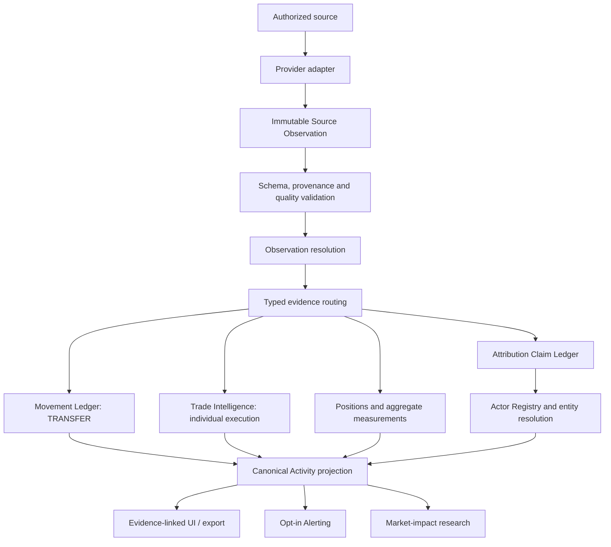

# IWFI Integrated Actor Activity Flow — Architecture Contract

Status: proposed integration architecture for Issue #50. This document composes merged contracts; it does not authorize provider access or production ingestion.

## 1. Architectural objective

Provide one auditable path from external evidence to a user-visible statement about actor activity, without changing the meaning or epistemic status of the underlying evidence.

The system must answer these questions independently:

1. What did the source actually report?
2. What happened on-chain or at a venue?
3. Which actor, if any, can be linked to that fact?
4. What is known as of the time the user asks?
5. What remains unknown, disputed, delayed, partial or outside source coverage?

A valid execution may have an unknown participant. An identified actor may have no known trade. A transfer may be real without being a purchase or sale. These are valid outcomes, not pipeline errors.

## 2. Component boundaries and ownership

| Component | Owns | Consumes | Produces | Must not do |
|---|---|---|---|---|
| Provider adapter | Source-specific protocol, auth boundary, pagination and source semantics | Authorized provider response | Source Observation | Infer identity, trade intent or missing values |
| Observation validation | Schema, provenance, timestamps, asset/network, retention class and source quality | Source Observation | Validated / partial / delayed / quarantined observation | Repair silently, coerce missing to zero, discard adverse evidence |
| Observation resolution | Exact duplicate/revision/event identity under policy version | Observation collection | Resolution decision and explicit links | Fuzzy merge or choose a preferred provider when facts conflict |
| Attribution claim ledger | Append-only address/entity/classification assertions | Source observations and evidence | Attribution Claims | Turn labels into legal identity or ownership without evidence |
| Actor Registry | Actor identities, aliases, classifications, coverage and actor-to-actor relationships | Reviewed evidence and claim references | Bitemporal Actor records | Treat address/wallet as actor or infer beneficial owner |
| Movement Ledger | Individual on-chain transfer facts | Eligible Source Observations and claim references | Movement records | Create trades or buy/sell direction |
| Trade Intelligence | Individual venue/official execution facts | Individual-execution evidence | TradeExecution | Create execution from transfer, order, holding or aggregate flow |
| Positions / holdings | Reported exposure snapshots and revisions | Official or provider reports with stated scope | PositionSnapshot | Claim the underlying execution or participant side from a balance change |
| Market Participant Intelligence | Venue, broker, custodian, OTC and market-maker context | Evidence-backed actor and relationship facts | Contextual classifications | Assume custody or venue equals beneficial ownership |
| Canonical Activity projection | Stable, typed presentation of source facts and derived assessments | Movements, trades, positions, aggregate metrics, attribution claims | ActorActivityEvent | Erase original event type or promote inference to fact |
| Alerting | User-authorized notification policy | Canonical Activity events | Alert references | Poll, notify or monitor without explicit opt-in |
| Market-impact research | Tested hypotheses about activity and price | Point-in-time activity + market snapshots | ImpactAssessment | Treat temporal correlation as causality |

The components are logical boundaries. This issue does not select physical services, databases, queues, frameworks or deployment topology.

## 3. End-to-end component flow



Routing is type-driven. A source observation of type `ON_CHAIN_TRANSACTION` may support a Movement. An observation of type `EXCHANGE_FLOW_METRIC` or `ETF_FLOW_METRIC` remains a measurement. A venue execution record may support a TradeExecution only when it describes an individual execution. No component may cast one type into another.

## 4. Sequence: from observation to activity

```mermaid
sequenceDiagram
  participant S as Authorized Source
  participant A as Adapter
  participant O as Observation Validator
  participant R as Resolution Policy
  participant D as Domain Router
  participant I as Identity/Actor Services
  participant P as Activity Projection
  participant U as User Interface

  S->>A: Source record (permitted endpoint)
  A->>O: SourceObservation + provenance + timestamps
  O->>O: Schema, quality, retention and asset/network checks
  O->>R: Valid / partial / delayed observation
  R->>R: Deduplicate exact repeats; preserve conflicts/revisions
  R->>D: Immutable observation + resolution decision
  D->>I: Attribution claim / transfer / trade / position by explicit type
  I->>I: Resolve actor only with scoped, time-valid evidence
  I->>P: Typed fact + identity status + evidence references
  P->>P: Preserve type, event time, known time and uncertainty
  P->>U: Activity view with evidence, coverage and limitations
```

The sequence is conceptual. It does not imply that all branches run for every observation. A transfer observation does not enter Trade Intelligence. An aggregate flow does not enter the Movement Ledger or TradeExecution.

## 5. Canonical relationships and identifiers

The following IDs remain distinct and are never substituted for one another:

- `observation_id`: immutable IWFI source-observation identity.
- `claim_id`: append-only attribution assertion identity.
- `movement_id`: one network-specific transfer-event identity.
- `execution_id`: one individual trade-execution identity.
- `actor_id`: internal economic/organizational subject identity.
- `position_snapshot_id`: one reported position snapshot/revision.
- `activity_event_id`: projection identity for a canonical activity view.
- `alert_id`: one user-authorized notification record.

### Idempotency and deduplication

- Source record repeat: provider + endpoint + source record ID + payload hash. Same record ID with a different hash is a revision/conflict candidate, not an overwrite.
- Transfer event: network ID + canonical transaction ID + protocol-specific event locator. Transaction hash alone is insufficient.
- Trade execution: venue + instrument/market + source execution ID when provided. If no stable source execution ID exists, do not fuzzy-deduplicate by price/time/quantity alone; preserve the source observation and mark event identity unresolved.
- Actor: stable IWFI actor ID. Names, tickers, labels and addresses are not actor primary keys.
- Activity projection: deterministic projection version + source domain record ID + projection policy version. A new policy version creates a new projection version rather than rewriting old evidence.

All keys are scoped to their domain. Matching timestamps or quantities do not establish identity across domains.

## 6. Temporal and epistemic propagation

Every stage preserves the original source event time and the time IWFI could know the fact. At minimum the integrated view must retain:

- `event_time_utc`: when the source says the event occurred.
- `published_at_utc`: when the source published it, where available.
- `available_at_utc` / `retrieved_at_utc`: when the data became available to IWFI.
- `ingested_at_utc`: when IWFI stored/accepted the observation.
- `computed_at_utc`: when a derived record or projection was computed.
- `valid_from_utc` / `valid_to_utc`: when an assertion applies in the real world.
- `known_at_utc` / `recorded_at_utc`: when IWFI knew or recorded an assertion.

The as-of query must not expose an observation, claim, actor alias, relationship or correction before its knowledge time. A later label does not rewrite what IWFI knew historically.

Epistemic statuses are not interchangeable:
- `VERIFIED`, `PROVIDER_LABELLED`, `INFERRED`, `UNKNOWN`, `DISPUTED` remain explicit.
- `UNKNOWN` is not false and is not zero.
- `DISPUTED` does not resolve by provider priority or input order.
- `PARTIAL`, `DELAYED`, `DUPLICATE`, `INVALID` and `QUARANTINED` quality states remain separate from identity status.
- A later stage may reduce certainty or abstain; it may not silently promote certainty.

## 7. Canonical Activity Event projection

The canonical activity event is a read model/projection, not a replacement for source-domain records. Each event must include:

- `activity_event_id`, `projection_version`, `activity_kind` and `source_domain`;
- exactly one primary typed reference to a Movement, TradeExecution, PositionSnapshot, AggregateMeasurement or AttributionChange;
- asset and network/venue scope where applicable;
- actor reference only when a separate actor-attribution claim supports this exact activity; otherwise actor is null and attribution status is `UNKNOWN` or `DISPUTED`;
- separate `aggressor_side` and `participant_side` where the source domain is a trade;
- source event time, publication/availability/knowledge time and computation time;
- source observation IDs, claim IDs, supporting evidence and counterevidence references;
- source quality, coverage state, uncertainty/abstention reason and policy version.

The projection must not use a generic `BUY` or `SELL` label for a transfer, position change or aggregate flow. If the activity is an individual trade but the participant is unknown, it may show the venue execution and aggressor side while the participant remains UNKNOWN. The UI must distinguish “venue aggressor bought/sold” from “named institution bought/sold”.

## 8. Synthetic end-to-end examples

All examples below are synthetic and define expected semantics, not provider capability.

### A. Confirmed public BTC execution; customer unknown

- Source: venue execution record.
- Observation: individual BTC/USDT execution.
- TradeExecution: `EXECUTED`, `aggressor_side=BUY`.
- Participant: `participant_attribution_status=UNKNOWN`, `participant_actor_id=null`, `participant_side=UNKNOWN`.
- Activity projection: `TRADE_EXECUTION` with venue aggressor BUY; no institution/whale buyer is named.
- Prohibited result: “Fund X bought BTC.”

### B. BTC transfer to an exchange-labelled address

- Source: Bitcoin transaction observation with a valid output locator.
- Movement: `TRANSFER`, amount and addresses as observed.
- Attribution claim: destination `PROVIDER_LABELLED` as an exchange deposit address.
- Activity projection: transfer to an address labelled by the provider, with claim provenance and validity interval.
- Prohibited result: “The owner sold BTC” or “the exchange bought BTC.”

### C. ETH ETF holdings or net-flow disclosure

- Source: official fund/issuer disclosure or aggregate provider metric.
- Position/measurement: reporting period, quantity, unit, publication time and revision retained.
- Activity projection: `POSITION_CHANGE_REPORTED` or `AGGREGATE_FLOW_REPORTED`.
- Prohibited result: manufacture one or more individual TradeExecution records or claim an exact execution time.

### D. Inferred whale accumulation

- Evidence: multiple time-valid transfer and balance observations associated with a provisional cluster under a documented methodology.
- Assessment: `INFERRED`, with supporting and counterevidence, window, coverage and alternatives.
- Activity projection: `ACCUMULATION_HYPOTHESIS`, explicitly not a trade fact.
- Prohibited result: rename the cluster as a legal person or assert a confirmed BUY.

### E. Contradictory identity labels

- Evidence: two incompatible provider/reviewer claims about the same address or alias.
- Resolution: preserve both claims; mark attribution `DISPUTED`.
- Activity projection: actor remains unresolved/disputed; show both evidence references.
- Prohibited result: select the most recent, highest-ranked or first provider label without a documented adjudication.

### F. Actor known; no evidence of current activity

- Actor Registry: verified organization with valid aliases and documented coverage.
- Activity: no qualifying trade/transfer/position observation in the requested period.
- Projection: no activity event is emitted for that actor/period; coverage is shown as known, partial or unknown.
- Prohibited result: infer a purchase or sale from actor classification or market relevance.

## 9. Cross-source reconciliation and double-counting controls

- Custody, ownership, control, operation, management, sponsorship and investment are distinct relationship predicates.
- A custodian address is not the beneficial owner. An ETF issuer, fund, administrator, authorized participant, broker and custodian remain separate actors unless explicit evidence links them.
- A transfer between two addresses attributed to the same actor is still a transfer; it is not automatically an external buy/sell or a new holding.
- A movement into an exchange cluster and an exchange flow metric may describe overlapping underlying activity. They are not summed until an explicit reconciliation rule establishes disjoint coverage.
- ETF flow, reported holdings, secondary-market ETF trades and BTC/ETH spot trades remain separate domains.
- Vendors may share upstream data. Two provider labels do not count as independent corroboration without upstream lineage evidence.
- If overlap cannot be resolved, the projection reports potential overlap and does not aggregate the amounts.

## 10. Degraded behavior and abstention

| Condition | Required behavior | Forbidden behavior |
|---|---|---|
| Source unavailable | Mark source coverage unavailable/stale; retain last-known timestamp | Present stale data as current |
| Partial response | Preserve received records and mark partial coverage | Fill missing rows with zero |
| Delayed disclosure | Preserve event and publication/availability times | Backdate knowledge or call it real-time |
| Unknown actor | Keep actor null / UNKNOWN | Guess from wallet proximity or label similarity |
| Contradictory claims | Preserve both; mark DISPUTED | Pick a winner by order or vendor rank |
| Missing event locator | Keep transfer identity unresolved/candidate | Merge by transaction hash alone |
| Aggregate flow only | Store as aggregate measurement | Decompose into trades or individual transfers |
| Trade with anonymous customer | Preserve execution and UNKNOWN participant | Attribute to the venue, broker or custodian |
| Source terms unclear | Quarantine raw payload; retain only legally permitted metadata/hash | Assume storage rights |
| Reorg/correction/revision | Append new observation/decision and link supersession | Rewrite prior evidence |

## 11. Alerts and user authorization

An Alert must reference one or more canonical Activity Event IDs and retain the rule version, trigger time, evidence references, quality/coverage state and delivery state.

Alert creation is downstream of a user-configured rule. Defaults are disabled. No background polling, scheduled monitoring, push notification, email or external delivery is enabled by this architecture. A future alerting implementation must separately specify opt-in, quiet hours, rate limiting, deduplication, revocation and audit.

## 12. Market-impact research boundary

Market-impact research consumes point-in-time Activity Events and market snapshots. It must preserve event availability/known time and cannot use later labels, disclosures or revised data as if they were known earlier.

An impact assessment must separate:
- temporal association;
- plausible mechanism;
- alternative explanations and counterevidence;
- event coverage and market-data quality;
- pre-registered evaluation window and benchmark;
- out-of-sample result, where evaluated;
- `causality_status=NOT_ESTABLISHED` unless a separate causal design supports stronger language.

No event is assigned price impact merely because the price moved after it.

## 13. Requirement-to-contract-to-test traceability

| Requirement / issue | Owning contract or component | Evidence/test boundary |
|---|---|---|
| #6 Source Observation | `source-observation.schema.json`, Source Observation v1.1 | Schema, timestamps, asset/network, retention and quality fixtures |
| #8 Attribution | `entity-attribution-claim.schema.json`, claim collection validator | Evidence/counterevidence, temporal validity, append-only supersession and conflict tests |
| #10 Movement | `movement-ledger.schema.json`, Movement Integrity validator | Event locator, source observation references, claim validity and no-trade semantics |
| #12 Observation resolution | Observation Resolution Policy v1.3.2 | Determinism, strong event identity, duplicates, conflicts and ineligible states |
| #41 / #51 Actor Registry | `actor-registry.schema.json`, Actor Registry validator | Alias ambiguity, bitemporal lookup, relationship conflict, unknown identity |
| #43 / #51 Trade Execution | `trade-execution.schema.json`, Trade Execution validator | Individual execution evidence, anonymous participant, separate sides, transfer/aggregate rejection |
| #42 Entity/wallet resolution | Attribution Claims + entity-resolution component to be specified | No clustering or legal identity inference in current contracts |
| #44 Positions | PositionSnapshot contract to be specified | Reported holdings remain distinct from executions |
| #45 Whale balances | Balance/cluster assessment contract to be specified | Cluster remains provisional; no legal identity implication |
| #46 Market participants | Actor Registry + explicit venue/custody relationship evidence | Custody/venue role is not beneficial ownership |
| #47 Canonical Activity | ActivityEvent projection to be specified | Typed reference, evidence propagation and no semantic promotion |
| #48 Alerting | Alert contract to be specified | Opt-in only, event reference and auditable trigger |
| #49 Market impact | ImpactAssessment / #29 dataset / #36 protocol | Point-in-time, benchmarks, alternatives and non-causal defaults |

This traceability matrix identifies existing contracts and remaining contract gaps. It does not claim that #42 or #44–#49 are implemented.

## 14. Implementation gates and out-of-scope work

1. Accept this integration architecture and its traceability boundaries.
2. Complete Issue #3 account/terms/sample due diligence. No provider is approved by this document.
3. Implement only the smallest read-only BTC/ETH vertical slice against one approved source.
4. Prove source semantics and participant identifiability using authorized real samples; synthetic tests only validate our own contracts.
5. Extend ActivityEvent/PositionSnapshot/Alert/ImpactAssessment contracts only when their owning Issues are addressed.

No connector, API key, paid subscription, polling, historical backfill, production persistence, alert delivery, trading, real identity attribution or market-impact claim is implemented by this document.
